# Nait-AWG

[](README.md) [](README.en.md)

Веб-панель для управления своим VPN-сервером AmneziaWG.

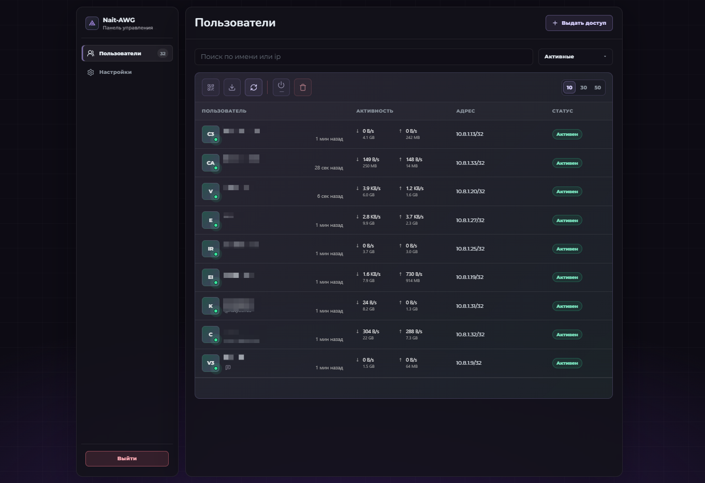

## Установка

Нужен VPS-сервер с **Ubuntu 24.04** и публичным IPv4.

Подключись к серверу и выполни:

```bash
curl -fsSL https://raw.githubusercontent.com/NaitSide/Nait-AWG/main/install.sh | sudo bash
```

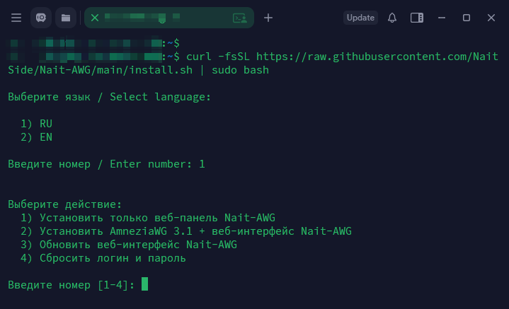

<details>
<summary>Перед установкой обязательно проверь доступность IP и SSH-порта сервера на <a href="https://iwtsy.com/">iwtsy.com</a>.</summary>

Если твой IP в бане, то продолжать установку Nait-AWG бессмысленно.

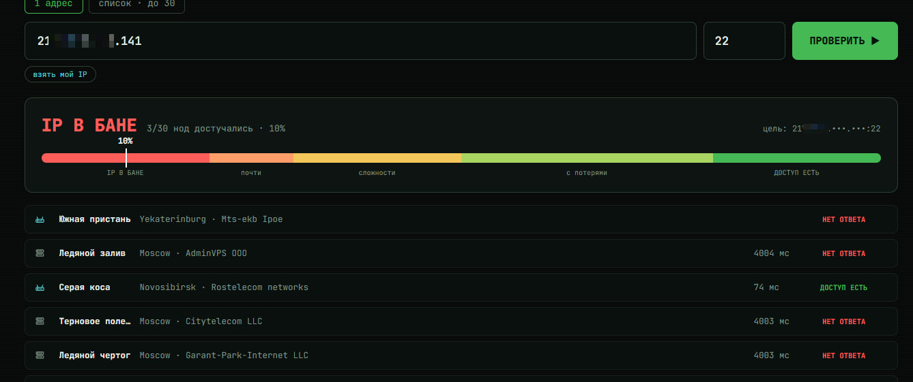

</details>

## О проекте

Мне нравился wg-easy: простая и удобная панель, в которой видно своих VPN-клиентов и легко управлять доступами. После перехода на AmneziaWG мне этого не хватало.

Я хотел оставить оригинальный движок AmneziaWG и добавить к нему понятный веб-интерфейс. Так появился Nait-AWG.

> **Публичная бета.** Я багов не нашёл, но они могут быть.

## Что есть в панели

### Создание клиента

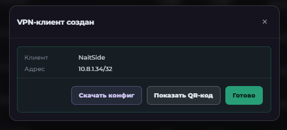

За пару кликов создаёшь клиента и получаешь конфиг для подключения.

### Трафик клиента

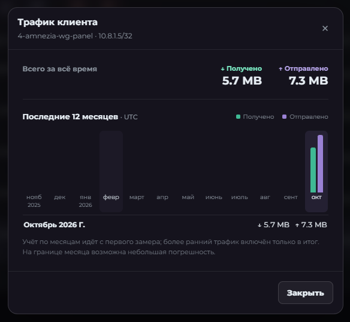

Видно, кто сколько гигов скачал или отправил и в каком месяце. Нажми на статус клиента — откроются общие счётчики и график по месяцам.

### Профиль клиента

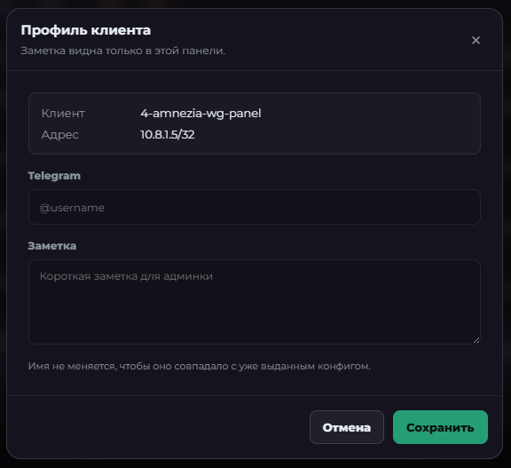

Можно указать Telegram человека, а в заметках — сколько он занёс и до какого числа.

### Управление доступом

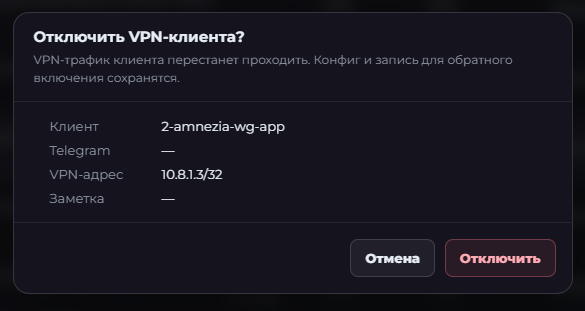

Можно временно отключить доступ, а потом включить его обратно. Конфиг и запись клиента сохраняются.

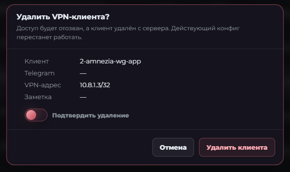

Если доступ больше не нужен — удалить клиента. Выданный ему конфиг перестанет работать.

### Конфиги и QR

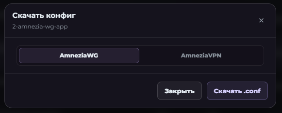

Можно скачать конфиг `.conf` для приложения AmneziaWG.

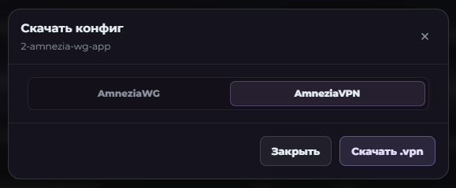

Или конфиг `.vpn` для приложения AmneziaVPN.

Для созданного клиента можно скачать конфиг как для приложения AmneziaVPN, так и для приложения AmneziaWG.

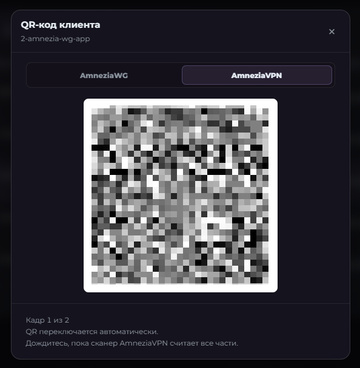

Если устройство рядом, можно отсканировать QR-код как в приложении AmneziaWG, так и в приложении AmneziaVPN.

QR-код для приложения AmneziaVPN — составной: на скриншоте конфиг закодирован в двух QR-кодах, которые переключаются автоматически. Дождись, пока приложение считает обе части.

На iPhone проверено — работает. На некоторых Android-устройствах сканер приложения AmneziaVPN может некорректно считывать составной QR-код. В этом случае можно скачать конфиг `.vpn`.

### Настройки и проверка версий

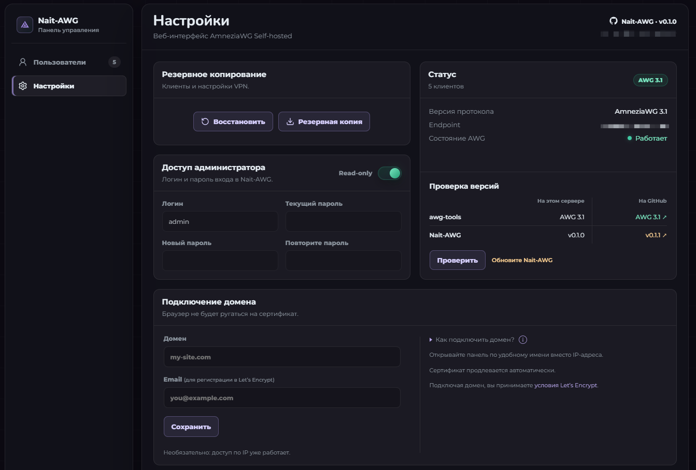

**Проверка версий.** Кнопка «Проверить» показывает опубликованную версию Nait-AWG, а также проверяет версию движка AmneziaWG (`awg-tools` — название движка на сайте разработчика). Чтобы обновить Nait-AWG, выполни в терминале ту же команду, что и для установки, и выбери **пункт 3**.

**Состояние AWG.** Статус «Работает» означает, что Docker-контейнер запущен и веб-панель видит движок. Чтобы проверить работу VPN, подключись с любого устройства и посмотри свой IP на [2ip.io](https://2ip.io/).

**Резервное копирование.** Можно сохранить клиентов и настройки VPN, а затем восстановить их на другом сервере. На новом сервере создаются новые ключи и конфиги — их нужно раздать пользователям. Логин и пароль панели, домен, сертификаты и системное окружение в копию не входят. [Состав и ограничения переноса](docs/administration.md#резервная-копия-и-перенос).

**Подключение домена.** Можно подключить свой домен, чтобы входить в веб-интерфейс без предупреждений браузера о сертификате.

> **Примечание:** при входе по IP с самоподписанным сертификатом браузер может не предлагать сохранить логин и пароль. У меня на Windows сохранение заработало после подключения домена.

**Параметры обфускации.** Их можно отредактировать вручную или включить Edit mode и нажать «Случайные параметры» внизу страницы — панель сама сгенерирует допустимые значения.

**Мультиязычность.** Доступны русский и английский языки. Язык переключается на экране авторизации.

## Что выбрать в установщике

Если AmneziaWG уже установлен через приложение AmneziaVPN — выбери **пункт 1**, чтобы добавить только веб-панель. Для чистого сервера выбери **пункт 2** — установятся AmneziaWG и панель. В конце установки получишь адрес для входа, логин и пароль.

## Если AmneziaWG установлен через приложение AmneziaVPN

В панели можно смотреть статус и трафик существующих клиентов, отключать их и удалять. Но заново скачать их конфиги не получится: для этого нужен закрытый ключ клиента, а на сервер AmneziaVPN передаёт только открытый. Исходные конфиги выданных клиентов приложение администратора не сохраняет для повторного скачивания.

Если конфиг у тебя сохранился, нажми оранжевый восклицательный знак рядом со статусом клиента и загрузи `.conf` или `.vpn`. После этого станут доступны скачивание конфига и QR-код.

## Обновление

Когда выйдет новая версия Nait-AWG, выполни в терминале ту же команду, что и для установки. После выбора языка выбери **пункт 3 — «Обновить веб-интерфейс Nait-AWG»**. Клиенты и настройки сохранятся. Этот пункт обновляет веб-панель; движок AmneziaWG он не обновляет.

> Когда выйдет обновление движка AmneziaWG, я добавлю в установщик отдельный пункт для его обновления. Сейчас такого пункта нет.

[История изменений](CHANGELOG.md) · [Подробная инструкция](docs/administration.md) · [Сторонние компоненты](THIRD_PARTY_NOTICES.md)
